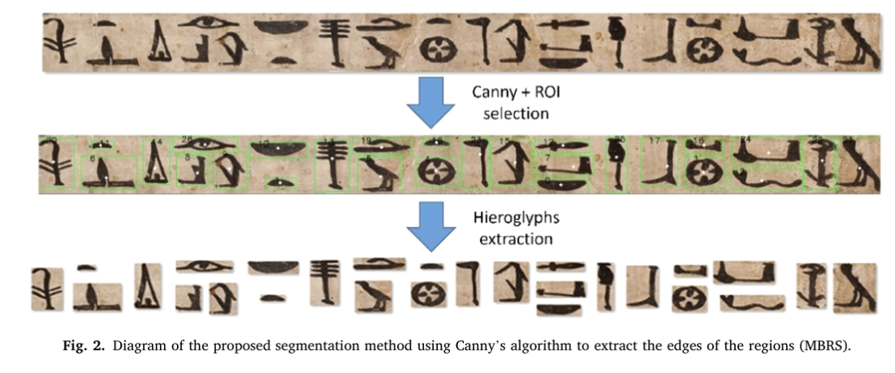
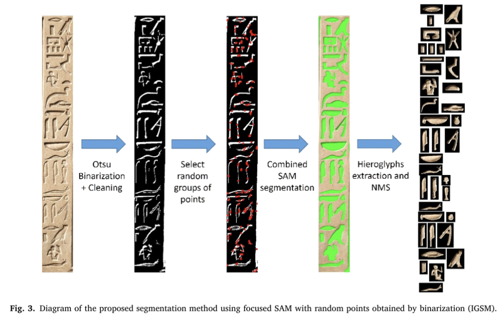
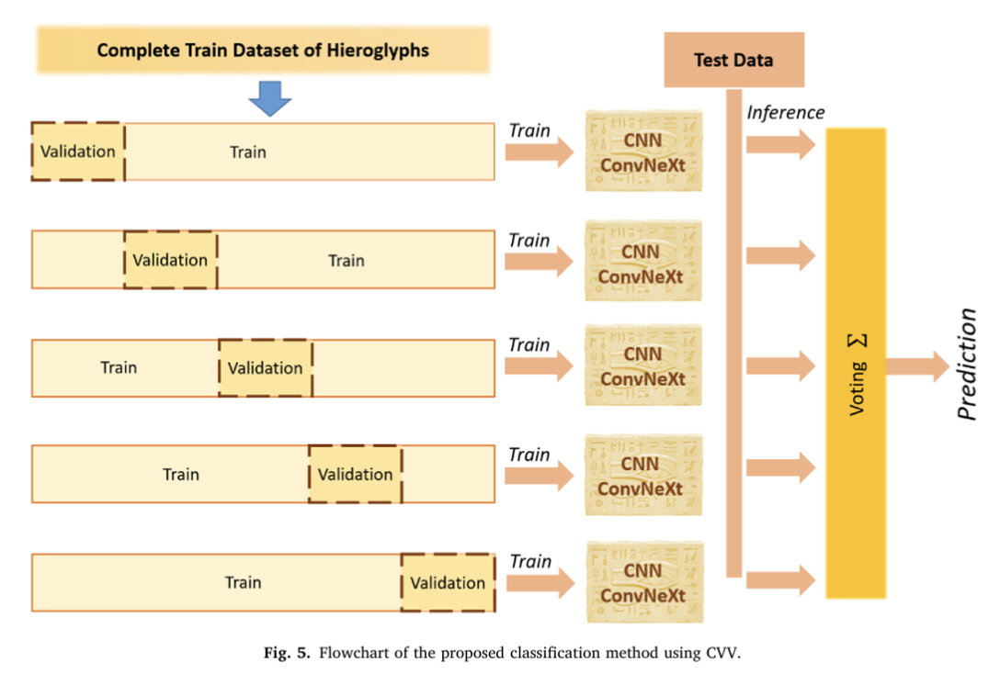
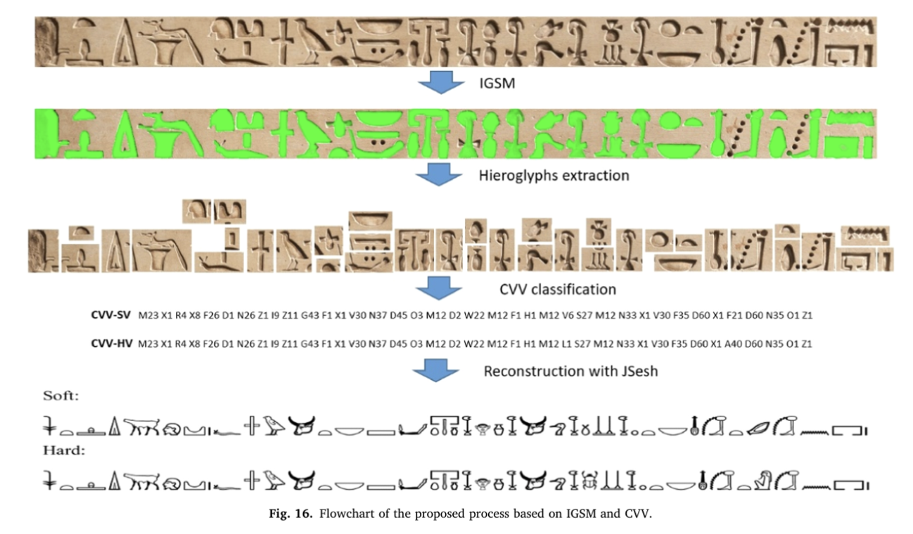

# 1. Recognition of Egyptian hieroglyphic texts through focused generic segmentation and cross-validation voting

## Abstract

- Contribution 1: Build a more complete dataset.

- Contribution 2: Combine segmentation and classification methods.
    * Segmentation: Separate symbols from the background and neighboring symbols so they can be extracted individually.
    * Classification: Decide which class each extracted symbol belongs to.

- ConvNeXt: CNN + Transformer

- Cross-validation voting: Train several models using different training/validation splits, then combine their predictions.

## Introduction

Method Based on Region Segmentation (MBRS) → Integrated Generic Segmentation Model (IGSM)

### Two previous approaches:

- Classical computer vision techniques: Do not generalize well.
- YOLO or Detectron2: Require more complex labeling of hieroglyphs.

### New idea:

Use prompts to guide the general-purpose SAM model, then classify the extracted symbols separately:

Image processing generates prompts → SAM extracts symbols → A classification model recognizes the symbols.

**Generic**: SAM has already learned general image segmentation capabilities. The authors want to use these capabilities to reduce the work needed to prepare detailed segmentation annotations specifically for hieroglyphs and retrain a segmentation model.

**Focused**: Running global segmentation directly on the whole image does not give the results they need. Instead, image processing methods generate specific prompts to make SAM focus on local regions and extract symbols one by one.

## Proposed approach

### Dataset

**Gardiner's Sign List**

Hieroglyphs are grouped according to the objects they depict, such as people, animals, plants, and body parts. Each symbol is assigned a unique code. For example, A1 represents a seated man, and G17 represents an owl.

In deep learning tasks for recognizing ancient Egyptian hieroglyphs, Gardiner codes are commonly used as class labels so the model can learn to recognize different hieroglyphic symbols.

The class name consists of a letter followed by a number. The Gardiner code is a unique identifier for each hieroglyph class.

**Egyptian Hieroglyphic Dataset**

- 310 different hieroglyph classes and 13,729 images.

- The hieroglyphs are grouped into folders according to the structure and typology defined by the Egyptologist Gardiner. The images are classified and labeled according to Gardiner's classes.

- The images have different backgrounds and sizes → Preprocessing → All images have the same width or height.

### Segmentation

| Approach | Principle | Suitable cases |
|---|---|---|
| MBRS | Use edges and regions to extract symbols. | Symbols stand out clearly from the background. |
| IGSM | Use prompt points to guide pretrained SAM. | Images where boundaries are harder to define. |

#### MBRS

Original image → Canny edge detection → Analyze separate regions → Find bounding boxes → Crop

The advantage is that the process is straightforward and makes it easy to build a traditional baseline.

Limitations: Not all edges in the image belong to symbols. Cracks, shadows, and background textures can also produce edges. Different strokes of a single symbol may also be split into several regions.

#### IGSM

1. **Otsu binarization and cleanup**: Convert the image into foreground and background to highlight areas such as carved marks and shadows. Then remove very small regions to reduce noise.

2. **Find connected regions and sample points**: Group connected foreground pixels into regions in the binary image, then randomly select prompt points from these regions. A connected region does not necessarily correspond to a complete symbol: it may be just one stroke, or it may connect several parts.

3. **Guide SAM with prompt points**: Give SAM the original image and the point coordinates to obtain candidate segmentation results. The authors found that a single segmentation pass could miss some regions, so they use multiple points and combine the results.

4. **Remove duplicates and filter results**: Use NMS to reduce duplicate results and filter out regions with unsuitable sizes, such as oversized regions that may come from damage to the stone.

Traditional image processing generates candidate clues + SAM segmentation + Postprocessing.

**How are segmentation results passed to the classifier?**

SAM mask → Determine the symbol's extent → Compute a bounding box → Crop a small image with local background from the original image → Classification

The authors could remove the background and keep only the symbol. However, their experiments showed that rectangular crops retaining the background gave better classification results, so they use these crops as the final input.

**Organizing the hieroglyphs so they can then be read**

Read from right to left and from top to bottom.

Not very important for our project.

### Classification

#### ConvNeXt

ConvNeXt is a convolutional neural network architecture, so it belongs to the CNN family. It comes from the 2022 paper A ConvNet for the 2020s. Starting from ResNet, the study borrows design ideas from modern vision networks to improve convolutional networks, resulting in the ConvNeXt family.

#### CVV classification

Generalizability → CVV

Can the model still correctly classify new images that were not used during training?

Several similar classifiers are trained using disjoint validation groups.

**Validation set**

Used to avoid overfitting.

| Data | Updates parameters? | Usage |
|---|---|---|
| Training set | Yes | Compute training loss, run backpropagation, and update parameters. |
| Validation set | No | Monitor generalization, select a model checkpoint, or decide when to stop. |

**Early stopping**

Usually, validation performance is monitored. Training stops after several epochs without improvement, and the best checkpoint is kept.

**Data distribution**

Split the training dataset into different training and validation folds.

* $\tau$: The full development dataset used for training and validation.
* $T_i$: The training set for model $i$.
* $V_i$: The validation set for model $i$.
* $k$: The number of models.

$$
\tau = \bigcup_{i=1}^{k} V_i
$$

Together, the validation groups cover the full development dataset.

$$
\bigcap_{i=1}^{k} V_i = \varnothing
$$

No sample appears in all validation groups at the same time.

$$
[\tau = T_i \cup V_i] \quad \forall i \in [1,k]
$$

For each model, its training and validation sets together make up the full development dataset.

$$
[T_i \cup V_i = \varnothing] \quad \forall i \in [1,k]
$$

A model's training and validation sets do not overlap.

**Output of all models**

For an input image $x_i$, model $i$ outputs:

$$
\mathbf p_i(x)=
[p_{i1}(x),p_{i2}(x),\ldots,p_{in}(x)]
$$

* $i$ is the model index.
* $j$ is the class index.
* $n$ is the total number of classes.
* $p_{ij}(x)$ is the probability assigned by model $i$ to image $x$ belonging to class $j$.

**Soft voting**

For each class, add up the models' probabilities with weights, then choose the class with the highest score.

$$
q_j(x)=\sum_{i=1}^{k}w_i\,p_{ij}(x)
$$

$$
S(x)=c_{\arg\max_j q_j(x)}
$$

Here, $c_j$ is the label of class $j$, and $\arg\max$ returns the index of the class with the highest score.

$$
w_i=\frac{1}{k}
$$

**Hard voting**

$$
bij(x) =
\begin{cases}
1,&j\text{ is the class with the highest probability predicted by model }i\\
0,&\text{otherwise}
\end{cases}
$$

Convert each model's probability vector into a voting vector.

$$
H(x)=c_{\arg\max_j\sum_{i=1}^{k}w_i\,b_{ij}(x)}
$$

Then add up these votes with weights.

**Difference**

* Hard voting keeps only each model's first choice.
* Soft voting keeps the probability distribution across classes.

**Random data augmentation**

* For classes with fewer samples than a certain threshold, add augmented samples.
* For classes with too many samples, remove some images.
* Set the maximum number of training images per class to twice the average number per class.

Augmentation and sample count adjustments are done together. This does not mean simply duplicating all classes to the same size or only applying random transformations.

| Augmentation | Setting |
|---|---|
| Horizontal and vertical translation | Maximum 10 pixels |
| Small random rotations | 5 degrees |
| Random scaling | 0.90–1.10 |
| Horizontal flipping | |

The total number of images in the training set was 9359 and, after data augmentation, 18,71.

## Experiments and results

### Individual classification results

Accuracy rises quickly during the first few epochs, showing that the model is learning.
Training accuracy then approaches 100%.
Validation accuracy stays around 96%–97%, with small fluctuations.

Training loss keeps decreasing and ends up very low.
Validation loss drops at first, then mostly levels off.
Further reductions in training loss later on do not lead to the same level of improvement on the validation set.

The model's best validation performance is at epoch 13, with an accuracy of about 0.967 and a loss of about 0.150.

#### Results of CVV

| Metric | Usual meaning in classification |
|---|---|
| **Accuracy** | The proportion of all test samples that are correctly predicted. |
| **Balanced Accuracy** | Usually the average recall across classes, reducing the influence of larger classes on the result. |
| **Precision** | For a given class, how many samples predicted as that class actually belong to it. |
| **Recall** | How many of a class's actual samples are correctly recognized. |
| **F1** | Combines precision and recall. |

* The five individual models have similar accuracies, around 92.6%–93.3%.
* Soft voting reaches 96.0%, an improvement of 2.7 percentage points over the best individual model. So, in this test, combining predictions does perform better than using a single model.
* Soft voting performs slightly better than hard voting in this table.

**Confusion matrix**

* Vertical axis, Actual: The true class.
* Horizontal axis, Predicted: The predicted class.
* Diagonal: Correct predictions.
* Off-diagonal: Confusion between classes.

### Individual segmentation results

Text region → MBRS or IGSM → Extract individual symbols → CVV classification → Reproduce with JSesh

**ALL and ONLY**

| Scope | Which symbols are evaluated? |
|---|---|
| **ALL** | All symbols in the stele, including classes not covered by the classification dataset. |
| **ONLY** | Only symbols whose classes are covered by the classification dataset. |

| Method | Scope | Accuracy | F1 |
|---|---|---:|---:|
| MBRS + soft voting | ALL | 0.712 | 0.539 |
| IGSM + soft voting | ALL | **0.893** | **0.799** |
| MBRS + soft voting | ONLY | 0.759 | 0.559 |
| IGSM + soft voting | ONLY | **0.952** | **0.908** |

IGSM clearly outperforms MBRS under both ALL and ONLY. Based on this, the authors consider SAM-assisted extraction more effective in this experiment.

IGSM improves from 89.3% under ALL to 95.2% under ONLY. This shows that some of the difficulty comes from classes not covered by the training data.

Better extraction can improve the recognition that follows.

Even with good extraction, limited class coverage still restricts the system's performance.

### Comparison with state-of-the-art datasets and hieroglyph recognition approaches

| Method, as reported in Table 8 | Dataset | Images | Classes | Reported accuracy |
|---|---|---:|---:|---:|
| HOG + SDM | Franken | 3,993 | 161 | 0.855 |
| Detectron2 + Glyphnet | Barucci | 4,309 | 40 | 0.934 |
| R-CNN + SiameseNN | Sobhy | 4,210 | 172 | 0.885 |
| IGSM + CVV-SV | This paper | 13,169 | 164 | 0.940 |