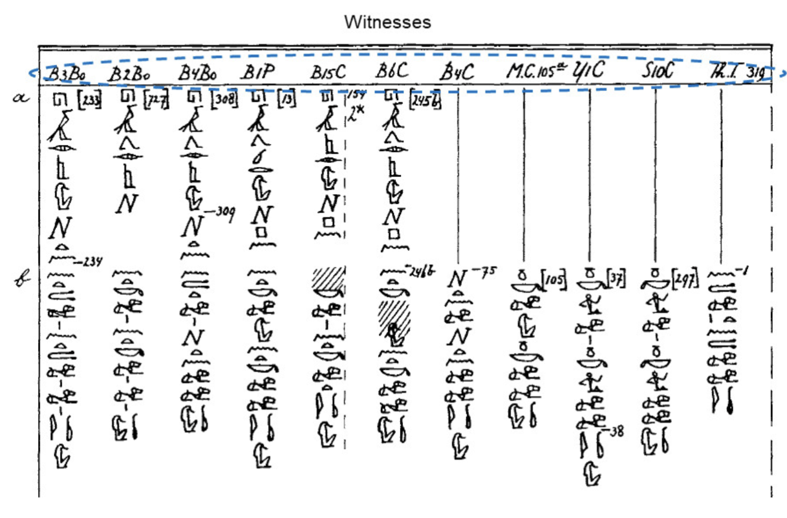
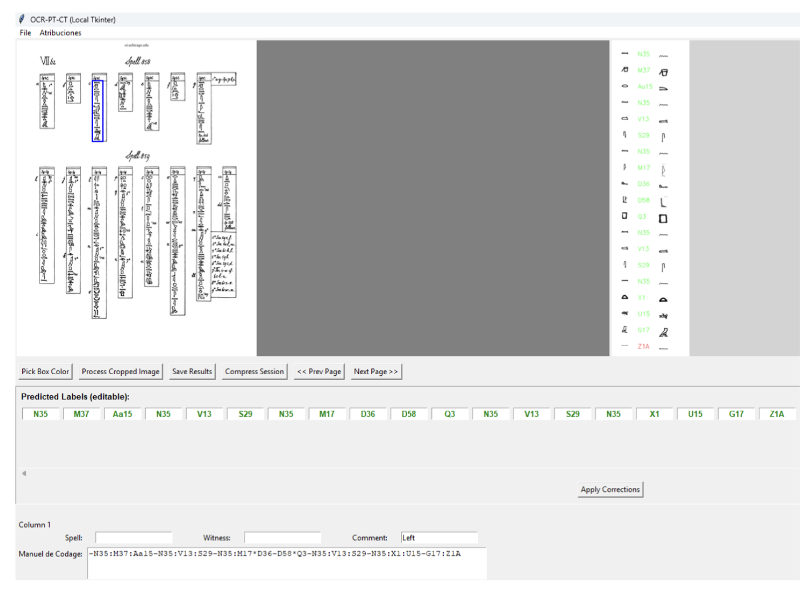
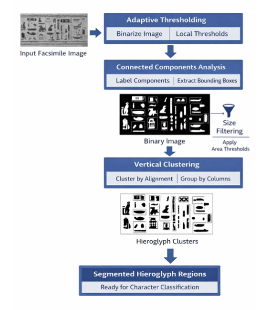
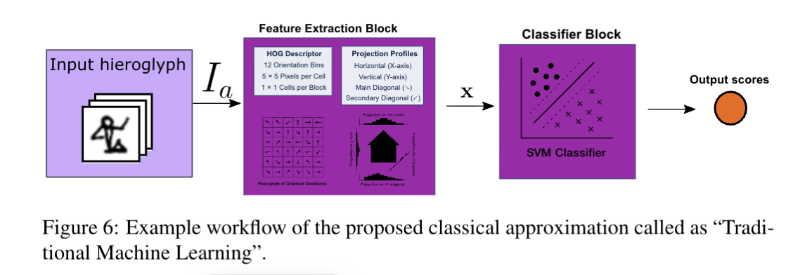
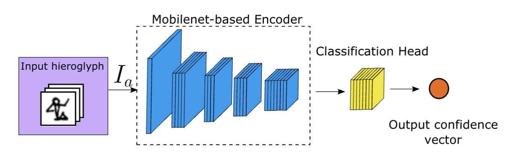
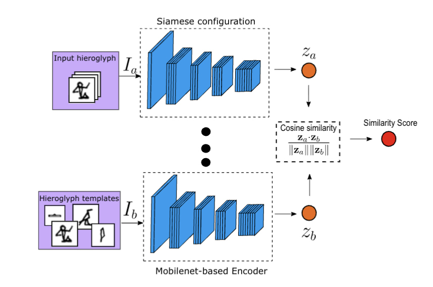
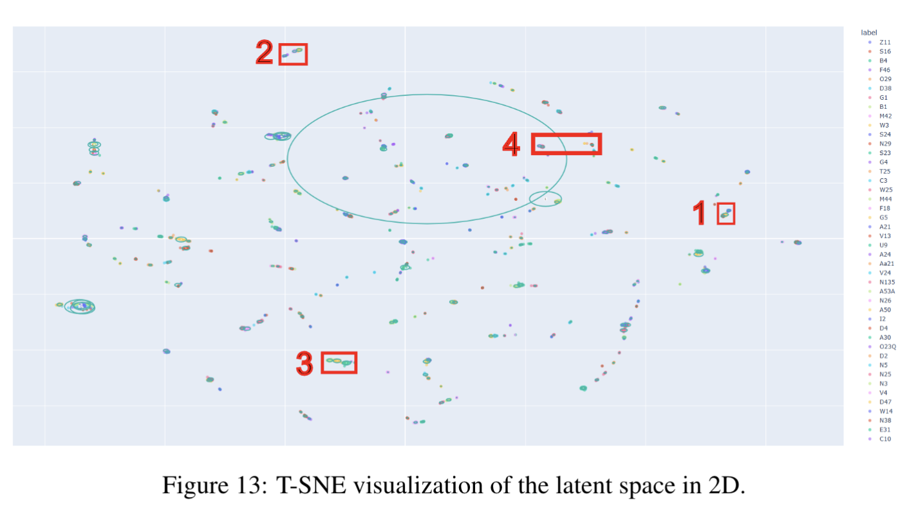

# 3. The OCR-PT-CT Project: Semi-Automatic Recognition of Ancient Egyptian Hieroglyphs Based on Metric Learning

## Abstract

**Motivation**

Classes with few samples are difficult to train on.

The standard CNN approach trains MobileNet to recognize 140 symbol classes and reports a performance of about 93.87%. However, performance drops noticeably for classes with too few samples.

The authors therefore introduce metric learning to learn a feature space that makes symbols easier to compare:
Features from the same class stay close together, while features from different classes are separated. This approach reaches 97.70%.

New symbols that were not seen during training can also be added flexibly. In practice, this means using reference images of a new class to build a feature template and adding it to the recognition library, rather than recognizing any new symbol without reference samples.

## Introduction

Why can't methods used for modern OCR simply be applied directly?
Modern languages usually have large amounts of training data available, which provides better conditions for OCR.
Ancient scripts face three main challenges:

* Limited corpora.
* Complicated document preservation conditions.
* Complex writing styles.

Recognition methods need to account for the data available for ancient scripts, especially limited samples and variations in glyph shapes.

### Contributions

1. Propose a deep metric learning model for recognition under severe class imbalance.
2. Compare it with traditional machine learning and a standard end-to-end CNN to assess its actual benefits.
3. Evaluate it on pages not used during training to test its ability to process new pages.

## General Overview of the Proposal

### General block diagram of the proposed hieroglyph segmentation and classification

Digitized document

$\downarrow$

The user selects the text region to process

$\downarrow$

Symbol segmentation and classification

$\downarrow$

Post-processing and transcription

$\downarrow$

Display the results in the web interface

Semi-automatic: The user first selects the target region, and the system then processes the symbols within it.

#### Segmentation module

| Step | What does it do? | Why is it needed? |
|---|---|---|
| **1. Adaptive thresholding** | Separate the image into foreground and background. | Make it easier to extract text strokes. |
| **2. Connected components analysis** | Find regions of connected foreground pixels. | Generate candidate symbol regions. |
| **3. Size filtering** | Remove regions that are too small or too large. | Reduce noise and irrelevant content. |
| **4. Grouping by vertical columns** | Organize candidate regions based on their positions. | Match the text layout and help establish the order. |

#### Classification stage

After segmentation, the candidate symbol images enter the classification stage.
The authors' main method is Deep Metric Learning.

The model outputs a "numerical fingerprint": this is actually the feature vector produced by the CNN.

Symbol image $\rightarrow$ CNN $\rightarrow$ Feature vector

The authors want:

* Different images of the same symbol class to have similar features.
* Images from different symbol classes to have distinguishable features.

The feature of the image to be recognized is then compared with the average feature vector of each known class, and the most similar class is selected.

#### Traditional machine learning and standard CNNs

| Method | Recognition approach |
|---|---|
| Traditional machine learning | Design visual features by hand, then pass them to a classifier. |
| Standard end-to-end CNN | The network directly outputs a classification score for each class. |
| **Deep metric learning** | Learn a feature representation, then classify by similarity. |

#### Post-processing and transcription (not important for us)

After predicting the codes for the symbols, the results still need to be organized into a transcription and displayed in the interface for the user to check.

### Corpus Description and Processing

#### Data corpus used in this work

The digitized corpus contains 163 spells, organized into two PDF volumes.

For example, Figure 2 shows similar symbol sequences across different columns, with gaps and differences in appearance. **For the model, this provides different ways of writing the same symbol class.**

#### How documents become a classification dataset (not very important for us)

---

PDF document page

$\downarrow$

The user manually selects vertical columns using the web tool

$\downarrow$

The segmentation program extracts individual symbols

$\downarrow$

Egyptologists check, organize, and label the results

$\downarrow$

Symbol images with class labels

---

#### Class imbalance in this dataset

The authors report a final dataset of 262 classes, labeled using Gardiner/MdC codes.

However, the class distribution is highly imbalanced:

* Common symbols may have more than a thousand samples.
* Rare symbols have very few samples.

This causes two related problems:

1. Common classes may have a greater influence on training.
2. Rare classes provide too little variation in appearance for the model to learn reliable recognition.

Class imbalance and a lack of samples are different issues: even if repeated sampling makes every class appear equally often, it does not add independent visual information for rare classes.

#### Data format

Every sample is a PNG image file, with a size of 100 × 100 pixels and a depth of 24 bits.

#### Data splitting (very interesting for us!!!)

The authors are concerned that training and test images from the same page may share many visual characteristics, such as:

- The same drawing or handwriting style.
- The same scan quality.
- Similar line thickness and noise.

If individual symbols are split randomly, the model may already have seen a page style during training that is very similar to the test samples.

The authors therefore hold out 10 complete pages for testing. These pages are not used for training or validation.

### Web and Local Application (not important)

Web application and local application.

Both versions support:

- Browsing document facsimiles.
- Selecting target regions.
- Running symbol segmentation and classification.
- Exporting transcription results and source information.

The same Python processing backend: Segmentation → Feature extraction → Classification.

**How to use**

1. Select and load a document.
2. Draw a bounding box around an ROI (Region of Interest) in the image.
3. Automatically extract individual symbol candidates.
4. Classify each candidate symbol.
5. Display the ordered recognition results for expert review.
6. Export a CSV file.

## Character Segmentation (may be important for us if a character consists of two or more parts)

The input is a facsimile region already selected by the user, containing several symbols.
The goal is to locate individual symbols and extract candidate regions for the classifier.

### 1. Adaptive Thresholding (different from Otsu)

It calculates a local threshold based on the neighborhood around each pixel: darker regions can use a lower threshold, while brighter regions use a higher one, allowing strokes to be extracted in each region.

### 2. Connected Components Analysis

Which foreground pixels are connected and can be grouped into the same region?

The program assigns each region an ID and records its position.
These region IDs are just image-processing labels.

### 3. Turning connected components into candidate symbol boxes

After finding a connected component, we can calculate its:

- Leftmost position $x_{\min}$.
- Rightmost position $x_{\max}$.
- Topmost position $y_{\min}$.
- Bottommost position $y_{\max}$.

These coordinates define the smallest axis-aligned rectangle enclosing the whole region:
a bounding box.

The binary image helps locate regions, while the bounding box gives the coordinates for cropping a candidate image from the corresponding source image.

The paper calls each connected component a potential hieroglyph.
"Potential" matters because connected components only depend on pixel connectivity; they do not understand symbol structure.

| Situation | What might connected components analysis produce? |
|---|---|
| All strokes of a symbol are connected. | One region, possibly corresponding to a complete symbol. |
| A symbol consists of several disconnected strokes. | Several regions, splitting the symbol apart. |
| Two symbols touch or are connected by noise. | One region, merging several symbols. |

Stains, borders, and editorial marks can also form connected components.

### 4. Size Filtering

Remove clearly unsuitable candidates based on their area or dimensions.

How are the thresholds chosen?
The paper says they are chosen empirically, based on the expected size of symbols in the facsimiles.
The filtering logic can be understood as:
$
A_{\min}\leq A\leq A_{\max}
$
combined with checks on the region's width and height. Here, $A$ is the area being checked.

### 5. Clustering (I'm still confused about this part)

After filtering, the system still has a set of candidate symbols scattered across different positions in the image.

The authors use the corpus layout: these texts are mainly arranged in vertical columns, so they try to identify which candidate regions belong to the same column.

They use the candidates':

- Centroids, meaning their geometric center positions.
- Or bounding box positions.

Symbols in the same vertical column usually have similar horizontal positions but different vertical positions.

## Character Classification

Three different strategies are compared:

* Traditional machine learning: Handcrafted features (HOG) with an SVM classifier.
* End-to-end deep classification: Directly fine-tune a CNN using a weighted loss function.
* Deep metric learning: A CNN generates feature embeddings, which are classified by similarity to class prototypes.

### Traditional Machine Learning (Classifiers)

First describe the images using predefined rules, then train an SVM to predict classes from these descriptions.

#### Feature 1 - HOG (Histogram of Oriented Gradients)

1. Calculate image gradients.
2. Divide the image into small regions (5×5 pixels).
3. Group gradient directions into a histogram.
4. Normalize by block.
5. Concatenate the results into a vector, giving $h$.

#### Feature 2 - Projection Profiles

Sum pixel values along rows or columns to describe how the shape is distributed across positions.

These profiles provide a global representation of the symbol's mass distribution.

This gives $p_x$ and $p_y$.

#### Feature 3 - Diagonal Projections

The authors also sum pixels along two diagonal directions:

- Main diagonal direction: Top-left to bottom-right.
- Secondary diagonal direction: Top-right to bottom-left.

Rather than just summing along the two central diagonals, they sum along a series of parallel diagonals to obtain two groups of features.
These add information about diagonal structures, such as slanted outlines and the distribution of diagonal strokes.

This gives $p_\diagdown$ and $p_\diagup$.

#### Concatenated feature vector

$$
\mathbf x=
[
\mathbf h,\,
\mathbf p_x,\,
\mathbf p_y,\,
\mathbf p_{\diagdown},\,
\mathbf p_{\diagup}
]
$$

$$
\mathbf x\in\mathbb R^m
$$

Here, $m$ is the total dimensionality after concatenating all features.

#### Classification using a linear SVM

1. Sweep hyperparameters and select a configuration using the validation set:
   The authors try different parameter combinations and choose the setup based on validation performance, ending up with a linear-kernel SVM.
   This means parameter selection relies on the validation set, while the test set is used for later evaluation.
2. Use the same data splits across methods:
   The authors follow the predefined training, validation, and test splits in Table 1, rather than creating a separate random split for the SVM.
   This reduces the chance that a method performs better simply because it happened to get easier data.
3. Set class weights based on the training distribution:
   Misclassifications of classes with fewer samples receive a larger penalty, encouraging the classifier to pay attention to rare symbols.
   This changes the cost of errors across classes during training. It does not add new real samples or change how HOG is calculated.

### End-to-End Deep CNN (Classifier)

#### Backbone

MobileNetV2 pretrained on ImageNet.

---

Symbol image

$\downarrow$

MobileNetV2 feature extraction backbone

$\downarrow$

Flatten

$\downarrow$

Fully connected layer: 512 units

$\downarrow$

ReLU

$\downarrow$

Fully connected layer: C units

$\downarrow$

Softmax

$\downarrow$

Probabilities for C classes

---

**Weighted categorical cross-entropy**

If every image contributes to the loss in the same way, class A appears more often in the overall training objective. The model may focus more on improving common classes, while rare classes still perform poorly.

Each class is assigned a weight $w_c$, usually inversely proportional to its frequency in the training set: the rarer the class, the greater the penalty for an error on one of its samples.

#### Loss function

$$
\mathcal L
=
-\frac{1}{N}
\sum_{i=1}^{N}
\sum_{c=1}^{C}
w_c\,y_{ic}\log(p_{ic})
$$

| Symbol | Meaning |
|---|---|
| $N$ | Number of samples in the current batch |
| $C$ | Total number of classes |
| $w_c$ | Weight for class $c$ |
| $y_{ic}$ | Whether sample $i$ belongs to class $c$: 1 if it does, otherwise 0 |
| $p_{ic}$ | The model's predicted probability that sample $i$ belongs to class $c$ |

Standard cross-entropy × Weight of the true class.

### Deep Metric Learning (Classifiers and Clustering)

The authors aim to address limited samples and class imbalance.
Instead of directly outputting class probabilities as in the previous section, this method first learns a feature space where:

- Intra-class distances are small: Different images of the same symbol have similar features.
- Inter-class distances are large: Images of different symbols have distinguishable features.

The core of metric learning: Through training, make feature similarity meaningful for classification.

#### How are feature vectors generated?

The authors use MobileNetV2 pretrained on ImageNet, remove the original classification head, and replace it with:

---

Symbol image

$\downarrow$

MobileNetV2

$\downarrow$

Flatten

$\downarrow$

Fully connected layer: 128 units

$\downarrow$

L2 normalization

$\downarrow$

128-dimensional feature vector

---

$$
\mathbf z=f(I)\in\mathbb R^{128}
$$

Here:

- $I$: The input image.
- $f$: The trained feature extraction network.
- $\mathbf z$: The image's embedding vector.

Here, 128 is the feature dimensionality, not the number of classes.

Training fine-tunes the whole network, including the MobileNetV2 backbone.

L2 normalization makes subsequent comparisons focus mainly on vector direction rather than length.

#### How is the similarity between two feature vectors calculated?

$$
s=
\frac{\mathbf z_a^\top\mathbf z_b}
{\|\mathbf z_a\|_2\|\mathbf z_b\|_2}
$$

It measures how close the vectors' directions are:

- Close to 1: Similar directions.
- Close to 0: Nearly orthogonal.
- Close to −1: Opposite directions.

Since the network outputs are already normalized, the formula simplifies to:

$$
s=\mathbf z_a^\top\mathbf z_b
$$

#### How is the model trained?

Siamese network: The authors use two branches with shared weights to process a pair of images.
Shared weights mean that both branches use the same parameters, rather than learning different feature extraction rules independently.

Training pairs are constructed dynamically:

| Image pair | Composition | Goal |
|---|---|---|
| **Positive pair** | Two different images from the same class | Increase similarity |
| **Negative pair** | Two images from different classes | Decrease similarity |

#### Cosine Contrastive Loss

$$
L(s,y)
=
(1-y)(1-s)^2
+
y\max(s-m,0)^2
$$

$y=0$: Same class.
$y=1$: Different classes.

* For same-class images: $y=0$.

The formula becomes:
$
L_{\text{same}}=(1-s)^2
$

To reduce the loss, the network needs:
$
s\rightarrow1
$
so that the feature directions of same-class images become as similar as possible.

* For images from different classes: $y=1$.

The formula becomes:
$
L_{\text{different}}=\max(s-m,0)^2
$

$m$ is the margin parameter.
This means:

- If images from different classes are still too similar, meaning $s>m$, a loss is incurred.
- Once $s\le m$, the pair is no longer penalized.

The authors therefore do not require all images from different classes to point in completely opposite directions; they only require similarity to become sufficiently low.

#### Data augmentation and training settings

Augmentation includes:

- Small rotations, limited to $\pm15^\circ$.
- Small horizontal and vertical shifts.
- Optional horizontal flipping.
- Random bands along the image borders.
- Circular occlusions.

The last two simulate imperfect drawings, missing strokes, or local damage.
Augmentation is used only for training, not for validation or testing.

Training uses Adam, together with:

- Mini-batch gradient descent.
- Early stopping based on validation loss.
- Learning rate reduction.

#### Creating a class mean feature vector

The authors average the features of the training images in each class:

$$
\mathbf c_k
=
\frac{1}{|S_k|}
\sum_{I_i\in S_k}f(I_i)
$$

Here:

- $S_k$: The set of training images for class $k$.
- $|S_k|$: The number of training images in that class.
- $\mathbf c_k$: The class prototype or centroid.

#### How is a new image classified?

First, extract its features:

$$
\mathbf z_{\text{new}}=f(I_{\text{new}})
$$

Then compare them with all class prototypes:

$$
s_k=
\frac{\mathbf z_{\text{new}}^\top\mathbf c_k}
{\|\mathbf z_{\text{new}}\|_2\|\mathbf c_k\|_2}
$$

Finally, select the class with the highest similarity:

$$
\hat k=\arg\max_k s_k
$$

#### How is a new class added?

The encoder always outputs 128 dimensions, regardless of whether there are currently 140 or 222 classes.
A new class can therefore be added by preparing labeled reference images, calculating its prototype, and adding it to the library, without having to modify a Softmax layer with a fixed number of output classes.

However, this can only work well if the encoder already preserves the features needed to distinguish that class. Metric learning does not automatically give a correct name to a class that has no reference prototype.

## Experimental Results

| Short name | Method |
|---|---|
| **Trad-ML** | Handcrafted features such as HOG and projections + Linear SVM |
| **CNN-End2End** | MobileNetV2 + Classification head, trained with weighted cross-entropy |
| **Deep-MML** | Learn features with a Siamese network, then classify using class prototypes |

### two experiment and two test data
* 140 classes: At least 25 samples per class.
* 222 classes: At least 2 samples per class.

| Test set | Input conditions | What does it mainly evaluate? |
|---|---|---|
| **Test 15%** | Pre-segmented single-symbol images randomly held out for testing | The classifier's ability to recognize new images |
| **Test 10 pages** | 10 complete held-out pages, requiring segmentation first | The system's performance on new pages |

### Balanced Accuracy

$$
\operatorname{BalancedAccuracy}
=
\frac{1}{C}\sum_{c=1}^{C}\operatorname{Recall}_c
$$

Calculate recall separately for each class, then take the average.

| Method | 140 classes: Random test | 222 classes: Random test | 140 classes: Held-out pages | 222 classes: Held-out pages |
|---|---:|---:|---:|---:|
| **Deep-MML** | **97.70%** | **95.90%** | **93.50%** | **88.90%** |
| Trad-ML | 92.46% | 89.64% | 88.43% | 78.81% |
| CNN-End2End | 93.87% | 70.70% | 83.93% | 54.79% |

### Explainability in Deep Metric Learning

The authors analyze the 128-dimensional features learned through metric learning.
Since the 128-dimensional space cannot be plotted directly, they use t-SNE to map it into two dimensions, producing Figure 13.

* Each point represents a symbol sample.
* Colors represent classes.
* Ellipses and other markers help show the distribution of each class.

Figures 14–17 zoom in on several error cases to connect classification confusions with the feature distribution. They show groups of classes that lie close together in the reduced-dimensional feature space. Looking at the symbols, these classes seem very similar; some even look identical to me, although they still remain somewhat separated in the plots.

