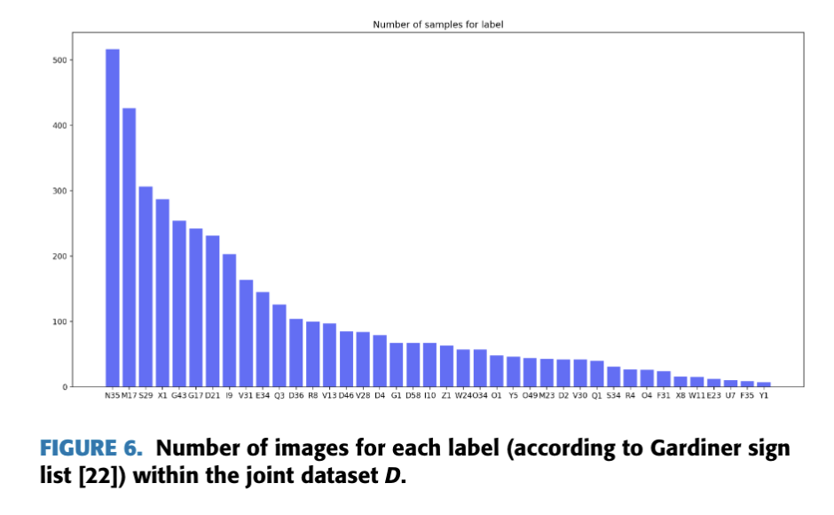
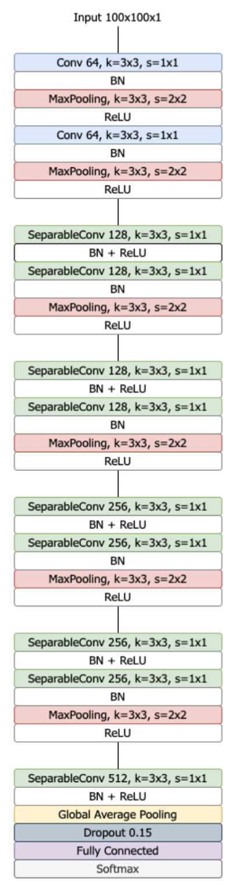

# 1. Recognition of Egyptian hieroglyphic texts through focused generic segmentation and cross-validation voting

## Abstract

- Contribution 1: Build a more complete dataset.

- Contribution 2: Combine segmentation and classification methods.
    * Segmentation: Separate symbols from the background and neighboring symbols so they can be extracted individually.
    * Classification: Decide which class each extracted symbol belongs to.

- ConvNeXt: CNN + Transformer

- Cross-validation voting: Train several models using different training/validation splits, then combine their predictions.

## Introduction

Method Based on Region Segmentation (MBRS) → Integrated Generic Segmentation Model (IGSM)

### Two previous approaches:

- Classical computer vision techniques: Do not generalize well.
- YOLO or Detectron2: Require more complex labeling of hieroglyphs.

### New idea:

Use prompts to guide the general-purpose SAM model, then classify the extracted symbols separately:

Image processing generates prompts → SAM extracts symbols → A classification model recognizes the symbols.

**Generic**: SAM has already learned general image segmentation capabilities. The authors want to use these capabilities to reduce the work needed to prepare detailed segmentation annotations specifically for hieroglyphs and retrain a segmentation model.

**Focused**: Running global segmentation directly on the whole image does not give the results they need. Instead, image processing methods generate specific prompts to make SAM focus on local regions and extract symbols one by one.

## Proposed approach

### Dataset

**Gardiner's Sign List**

Hieroglyphs are grouped according to the objects they depict, such as people, animals, plants, and body parts. Each symbol is assigned a unique code. For example, A1 represents a seated man, and G17 represents an owl.

In deep learning tasks for recognizing ancient Egyptian hieroglyphs, Gardiner codes are commonly used as class labels so the model can learn to recognize different hieroglyphic symbols.

The class name consists of a letter followed by a number. The Gardiner code is a unique identifier for each hieroglyph class.

**Egyptian Hieroglyphic Dataset**

- 310 different hieroglyph classes and 13,729 images.

- The hieroglyphs are grouped into folders according to the structure and typology defined by the Egyptologist Gardiner. The images are classified and labeled according to Gardiner's classes.

- The images have different backgrounds and sizes → Preprocessing → All images have the same width or height.

### Segmentation

| Approach | Principle | Suitable cases |
|---|---|---|
| MBRS | Use edges and regions to extract symbols. | Symbols stand out clearly from the background. |
| IGSM | Use prompt points to guide pretrained SAM. | Images where boundaries are harder to define. |

#### MBRS

Original image → Canny edge detection → Analyze separate regions → Find bounding boxes → Crop

The advantage is that the process is straightforward and makes it easy to build a traditional baseline.

Limitations: Not all edges in the image belong to symbols. Cracks, shadows, and background textures can also produce edges. Different strokes of a single symbol may also be split into several regions.

#### IGSM

1. **Otsu binarization and cleanup**: Convert the image into foreground and background to highlight areas such as carved marks and shadows. Then remove very small regions to reduce noise.

2. **Find connected regions and sample points**: Group connected foreground pixels into regions in the binary image, then randomly select prompt points from these regions. A connected region does not necessarily correspond to a complete symbol: it may be just one stroke, or it may connect several parts.

3. **Guide SAM with prompt points**: Give SAM the original image and the point coordinates to obtain candidate segmentation results. The authors found that a single segmentation pass could miss some regions, so they use multiple points and combine the results.

4. **Remove duplicates and filter results**: Use NMS to reduce duplicate results and filter out regions with unsuitable sizes, such as oversized regions that may come from damage to the stone.

Traditional image processing generates candidate clues + SAM segmentation + Postprocessing.

**How are segmentation results passed to the classifier?**

SAM mask → Determine the symbol's extent → Compute a bounding box → Crop a small image with local background from the original image → Classification

The authors could remove the background and keep only the symbol. However, their experiments showed that rectangular crops retaining the background gave better classification results, so they use these crops as the final input.

**Organizing the hieroglyphs so they can then be read**

Read from right to left and from top to bottom.

Not very important for our project.

### Classification

#### ConvNeXt

ConvNeXt is a convolutional neural network architecture, so it belongs to the CNN family. It comes from the 2022 paper A ConvNet for the 2020s. Starting from ResNet, the study borrows design ideas from modern vision networks to improve convolutional networks, resulting in the ConvNeXt family.

#### CVV classification

Generalizability → CVV

Can the model still correctly classify new images that were not used during training?

Several similar classifiers are trained using disjoint validation groups.

**Validation set**

Used to avoid overfitting.

| Data | Updates parameters? | Usage |
|---|---|---|
| Training set | Yes | Compute training loss, run backpropagation, and update parameters. |
| Validation set | No | Monitor generalization, select a model checkpoint, or decide when to stop. |

**Early stopping**

Usually, validation performance is monitored. Training stops after several epochs without improvement, and the best checkpoint is kept.

**Data distribution**

Split the training dataset into different training and validation folds.

* $\tau$: The full development dataset used for training and validation.
* $T_i$: The training set for model $i$.
* $V_i$: The validation set for model $i$.
* $k$: The number of models.

$$
\tau = \bigcup_{i=1}^{k} V_i
$$

Together, the validation groups cover the full development dataset.

$$
\bigcap_{i=1}^{k} V_i = \varnothing
$$

No sample appears in all validation groups at the same time.

$$
[\tau = T_i \cup V_i] \quad \forall i \in [1,k]
$$

For each model, its training and validation sets together make up the full development dataset.

$$
[T_i \cup V_i = \varnothing] \quad \forall i \in [1,k]
$$

A model's training and validation sets do not overlap.

**Output of all models**

For an input image $x_i$, model $i$ outputs:

$$
\mathbf p_i(x)=
[p_{i1}(x),p_{i2}(x),\ldots,p_{in}(x)]
$$

* $i$ is the model index.
* $j$ is the class index.
* $n$ is the total number of classes.
* $p_{ij}(x)$ is the probability assigned by model $i$ to image $x$ belonging to class $j$.

**Soft voting**

For each class, add up the models' probabilities with weights, then choose the class with the highest score.

$$
q_j(x)=\sum_{i=1}^{k}w_i\,p_{ij}(x)
$$

$$
S(x)=c_{\arg\max_j q_j(x)}
$$

Here, $c_j$ is the label of class $j$, and $\arg\max$ returns the index of the class with the highest score.

$$
w_i=\frac{1}{k}
$$

**Hard voting**

$$
bij(x) =
\begin{cases}
1,&j\text{ is the class with the highest probability predicted by model }i\\
0,&\text{otherwise}
\end{cases}
$$

Convert each model's probability vector into a voting vector.

$$
H(x)=c_{\arg\max_j\sum_{i=1}^{k}w_i\,b_{ij}(x)}
$$

Then add up these votes with weights.

**Difference**

* Hard voting keeps only each model's first choice.
* Soft voting keeps the probability distribution across classes.

**Random data augmentation**

* For classes with fewer samples than a certain threshold, add augmented samples.
* For classes with too many samples, remove some images.
* Set the maximum number of training images per class to twice the average number per class.

Augmentation and sample count adjustments are done together. This does not mean simply duplicating all classes to the same size or only applying random transformations.

| Augmentation | Setting |
|---|---|
| Horizontal and vertical translation | Maximum 10 pixels |
| Small random rotations | 5 degrees |
| Random scaling | 0.90–1.10 |
| Horizontal flipping | |

The total number of images in the training set was 9359 and, after data augmentation, 18,71.

## Experiments and results

### Individual classification results

Accuracy rises quickly during the first few epochs, showing that the model is learning.
Training accuracy then approaches 100%.
Validation accuracy stays around 96%–97%, with small fluctuations.

Training loss keeps decreasing and ends up very low.
Validation loss drops at first, then mostly levels off.
Further reductions in training loss later on do not lead to the same level of improvement on the validation set.

The model's best validation performance is at epoch 13, with an accuracy of about 0.967 and a loss of about 0.150.

#### Results of CVV

| Metric | Usual meaning in classification |
|---|---|
| **Accuracy** | The proportion of all test samples that are correctly predicted. |
| **Balanced Accuracy** | Usually the average recall across classes, reducing the influence of larger classes on the result. |
| **Precision** | For a given class, how many samples predicted as that class actually belong to it. |
| **Recall** | How many of a class's actual samples are correctly recognized. |
| **F1** | Combines precision and recall. |

* The five individual models have similar accuracies, around 92.6%–93.3%.
* Soft voting reaches 96.0%, an improvement of 2.7 percentage points over the best individual model. So, in this test, combining predictions does perform better than using a single model.
* Soft voting performs slightly better than hard voting in this table.

**Confusion matrix**

* Vertical axis, Actual: The true class.
* Horizontal axis, Predicted: The predicted class.
* Diagonal: Correct predictions.
* Off-diagonal: Confusion between classes.

### Individual segmentation results

Text region → MBRS or IGSM → Extract individual symbols → CVV classification → Reproduce with JSesh

**ALL and ONLY**

| Scope | Which symbols are evaluated? |
|---|---|
| **ALL** | All symbols in the stele, including classes not covered by the classification dataset. |
| **ONLY** | Only symbols whose classes are covered by the classification dataset. |

| Method | Scope | Accuracy | F1 |
|---|---|---:|---:|
| MBRS + soft voting | ALL | 0.712 | 0.539 |
| IGSM + soft voting | ALL | **0.893** | **0.799** |
| MBRS + soft voting | ONLY | 0.759 | 0.559 |
| IGSM + soft voting | ONLY | **0.952** | **0.908** |

IGSM clearly outperforms MBRS under both ALL and ONLY. Based on this, the authors consider SAM-assisted extraction more effective in this experiment.

IGSM improves from 89.3% under ALL to 95.2% under ONLY. This shows that some of the difficulty comes from classes not covered by the training data.

Better extraction can improve the recognition that follows.

Even with good extraction, limited class coverage still restricts the system's performance.

### Comparison with state-of-the-art datasets and hieroglyph recognition approaches

| Method, as reported in Table 8 | Dataset | Images | Classes | Reported accuracy |
|---|---|---:|---:|---:|
| HOG + SDM | Franken | 3,993 | 161 | 0.855 |
| Detectron2 + Glyphnet | Barucci | 4,309 | 40 | 0.934 |
| R-CNN + SiameseNN | Sobhy | 4,210 | 172 | 0.885 |
| IGSM + CVV-SV | This paper | 13,169 | 164 | 0.940 |

# 2. A Deep Learning Approach to Ancient Egyptian Hieroglyphs Classification (Glyphnet)

## Abstract

**Three well-known CNN architectures**

| Network | Main feature |
|---|---|
| **ResNet-50** | Uses residual connections to help train deeper networks. |
| **Inception-v3** | Uses different branches to process visual features at different scales. |
| **Xception** | Uses depthwise separable convolutions to handle spatial features and channel mixing separately. |

**Transfer learning**

* Training from scratch: Start with initialized weights and train the model using hieroglyph images.
* Transfer learning: Use pretrained weights, then train a classification head suited to the current classes.

**Core contribution**

Design Glyphnet specifically for hieroglyph classification: Modify an existing network architecture to create a CNN tailored to this task, named Glyphnet.

The idea behind it is:
General-purpose networks need to handle complex natural image classification tasks. For this hieroglyph classification task, could a simpler network still achieve good recognition results?

Glyphnet borrows the separable convolution design from Xception and reduces the network's complexity.

## Introduction

### Single hieroglyph classification

1. Use two labeled datasets: one public and one collected by the authors.
2. Test three existing CNNs.
3. Compare transfer learning with training from scratch.
4. Take inspiration from existing networks to design Glyphnet for the current task.
5. Compare the networks' classification performance through experiments.

## The problem of hieroglyph recognition and the datasets used

**The ancient Egyptian hieroglyphic writing system**

* Signifier: The outward form of a sign, which here means its visible shape.
* Signified: The meaning expressed by that form.

Recognizing a symbol's shape and explaining its role in a sentence are two different tasks. The classifier in this paper identifies the symbol's class; at this stage, it does not determine the symbol's linguistic function in a particular word.

### Original datasets

The authors use two datasets, called $D_1$ and $D_2$.
Each image contains a single hieroglyph, labeled with a Gardiner code.

| Item | $D_1$ | $D_2$ |
|---|---|---|
| Source | Public dataset, from photos of the interior walls of the Pyramid of Unas | Collected and labeled by the authors |
| Number of images | 4,310 | 1,310 |
| Number of classes | 172 | 48 |
| Original color format | Grayscale | RGB color |
| Original dimensions | $75\times50$ | Variable |
| Image characteristics | Fairly consistent source and physical medium | Different media, periods, and writers, including carved and painted signs |

Images in $D_1$ have a fairly similar overall style, while those in $D_2$ vary more in appearance.

The authors introduce $D_2$ to expose the model to more variation and improve generalization.

**Preprocessing of images belonging to the D2 dataset**

These images are cropped from scanned photos, and some have irregular outlines. Placing them in rectangular images leaves artificially added white areas.

Color crop → Convert to grayscale → Fit into a square while keeping the aspect ratio → Fill the artificial white areas with texture → Resize to $100\times100$

**Pseudorandom Gaussian texture** means random texture generated using a Gaussian distribution. The authors use it to fill the artificial white background so that these areas look closer to the original background around the symbol.

### Merged datasets

The authors first identify the classes shared by both datasets, then collect images of those classes from both sources.

$Y_1$ and $Y_2$ are the sets of class labels in the two datasets. The classes kept are:
$$
Y_1\cap Y_2
$$

$$
D=\{(x,y)\in D_1\cup D_2\mid y\in Y_1\cap Y_2\}
$$

The final dataset contains 4,309 images across 40 classes.

#### Class imbalance

The number of images varies a lot between classes. Some have hundreds of images, while others have very few. This is called class imbalance, and it may make the model learn more from the classes with more samples.

### Data augmentation and dataset balancing

First, split the dataset.

| Subset | Proportion | Purpose |
|---|---:|---|
| Training set | 70% | Update the model's parameters. |
| Validation set | 15% | Monitor generalization and select a model checkpoint. |
| Test set | 15% | Evaluate the final model. |

Then apply data augmentation only to the training set, so that an original image and its transformed versions do not end up in both the training and test sets.

The authors use the following transformations:

| Transformation | Setting in this paper |
|---|---|
| Horizontal and vertical translation | Maximum 10 pixels |
| Small rotations | $\pm10^\circ$ |
| Random scaling | 0.95–1.05 |
| Horizontal flipping | Left-right mirroring |

These transformations help the model handle changes in position, angle, and size, reducing its dependence on one fixed way of presenting a symbol.

The authors do not add the same number of images to every class. Instead, they:

* Add augmented samples to classes with fewer images than a certain threshold.
* Remove some images from classes with too many samples.
* Set the maximum number of training images per class to twice the average number per class.

*Add samples to minority classes and downsample classes with too many images.*

The original training set contains 3,014 images.
After augmentation and sample count adjustments, it contains 3,670 images.
Adding horizontally flipped versions increases this to 7,340 images.

## Architectures for hieroglyph classification

### Architectures for image classification

#### ResNet-50

[ResNet-50 link](https://arxiv.org/abs/1512.03385)

Residual Network: Add a shortcut alongside a convolutional block. Intuitively, adding more convolutional layers should allow the network to learn more complex features.
But deeper networks are also harder to train. During backpropagation, gradients pass through many layers and may become very small or very large. Even without obvious vanishing gradients, simply stacking more layers can make optimization harder. ResNet's main contribution is to make deep networks easier to optimize.

The residual network architecture addresses the vanishing/exploding gradient problem.

#### Inception-v3

Send the same input through several branches.

The question it addresses can be understood as: How large an area should a convolutional block look at to extract features?

Different ranges can focus on different structures.
For hieroglyph images:

* A smaller range may focus on stroke edges and endpoints.
* A larger range may focus on combinations of strokes and local outlines.

A simple CNN often uses just one kernel size in a given layer, such as $3\times3$. Inception sends the same input through several branches at once.

Each branch extracts different features, and their outputs are combined, usually by concatenating them along the channel dimension.

What does a $1\times1$ convolution do?

After the outputs of the previous layer's four branches are concatenated, they enter the next layer's $1\times1$ branch. It reads all the input channels at each spatial position and learns how to combine them.

#### Xception

The name comes from Extreme Inception and can be understood as taking Inception's idea further.

The key concept is depthwise separable convolution.

What two things does a regular convolution do at the same time?
Suppose the input has 32 channels. To produce one output channel, a regular $3\times3$ convolution kernel:

1. Looks at a nearby $3\times3$ spatial region in each channel.
2. Combines information from the different input channels.

In other words, a regular convolution handles both:

- Spatial relationships: How neighboring pixels or features combine.
- Channel relationships: How different feature channels combine.

The separable convolution used in Xception splits these tasks into two steps.

1. Depthwise convolution: Apply a spatial convolution independently to each input channel.
2. Pointwise convolution: Then use a $1\times1$ convolution to combine information across channels and set the number of output channels.

There is no activation function between these two operations. This does not mean the entire Xception network has no ReLU.

### Proposed network: Glyphnet

For this hieroglyph classification task, the number of layers and convolutional filters can be reduced to lower computation and the risk of overfitting while maintaining classification performance.

#### The network architecture

---

Input: 100×100×1 grayscale image

$$\downarrow$$

Block 1: Two regular convolutions, outputting 64 channels

$$\downarrow$$

Block 2: Two separable convolutions, outputting 128 channels

$$\downarrow$$

Block 3: Two separable convolutions, outputting 128 channels

$$\downarrow$$

Block 4: Two separable convolutions, outputting 256 channels

$$\downarrow$$

Block 5: Two separable convolutions, outputting 256 channels

$$\downarrow$$

Block 6: A separable convolution, outputting 512 channels

$$\downarrow$$

Global Average Pooling → Dropout → Fully Connected → Softmax

---

The spatial dimensions gradually shrink while the number of channels increases. Finally, the features are converted into class probabilities.

| Parameter count | Number |
|---|---:|
| Total parameters | 498,856 |
| Trainable parameters | 494,504 |

The model has about 499,000 parameters in total, far fewer than the more than 20 million in the general-purpose networks discussed earlier.
The main reasons are:

* Fewer layers and channels.
* Extensive use of separable convolutions.
* Global average pooling to keep the classification head small.

#### Network hyperparameters

| Item | Setting |
|---|---|
| Implementation framework | Keras, TensorFlow |
| Classification loss | Categorical cross-entropy |
| Optimizer | Adam |
| Batch size | 32 |
| Initial learning rate | 0.001 |
| Learning rate schedule | Halved every 15 epochs |
| Regularization | BN, L2 regularization on the fully connected layer, Dropout |
| Dropout rate | 0.15 |
| Weight initialization | Glorot Uniform |

#### Transfer learning

Use knowledge learned from one task for another related task.

In a CNN, this knowledge mainly lies in the learned convolution kernels and other parameters.
For example, after training on many images, a model has already learned to extract visual features such as edges, textures, and shapes. For hieroglyph images, these features can be reused rather than learned all over again.

Earlier layers usually extract more basic visual features, while later layers combine them to perform the specific classification task.

When the task changes, some basic features may still be useful, but the final classification rules usually need to change.

For example, if the original model's output classes differ from the hieroglyph classes, its original output layer cannot be used directly and needs to be replaced with a classification head suited to the new task.

The approach used in this paper: Freeze most of the lower layers and replace the top classification layers.
The authors apply the following steps to the pretrained networks introduced earlier:

1. Keep most of the original network's lower layers.
2. Freeze their weights.
3. Replace the original final output layers.
4. Train the newly added classification layers using hieroglyph data.

| Part | Used in the forward pass? | Parameters updated? |
|---|---|---|
| Frozen feature extraction layers | Yes | No |
| Newly added trainable classification layers | Yes | Yes |

## Experimental results

### Network performance using transfer learning

| Network | Accuracy | Precision | Recall | F1 |
|---|---:|---:|---:|---:|
| ResNet-50 | **0.906** | **0.882** | **0.825** | **0.840** |
| Inception-v3 | 0.864 | 0.730 | 0.737 | 0.717 |
| Xception | 0.834 | 0.715 | 0.720 | 0.703 |

### Network performance when trained from scratch

| Network | Accuracy | Precision | Recall | F1 |
|---|---:|---:|---:|---:|
| ResNet-50 | 0.945 | 0.919 | 0.905 | 0.903 |
| Inception-v3 | 0.948 | 0.917 | 0.904 | 0.900 |
| Xception | 0.956 | 0.919 | 0.930 | 0.919 |
| **Glyphnet** | **0.976** | **0.975** | **0.965** | **0.968** |

Glyphnet scores highest on all four metrics.
Its accuracy is 97.6%, higher than Xception, the best general-purpose network in this group. Its precision, recall, and F1 are also the highest.

The results support the authors' view that, under this paper's experimental conditions, the smaller task-specific network outperforms the comparison models.

### Stratified 5-fold cross-validation

Stratified:
Keep the class proportions as similar as possible across the splits.

Five-fold:
Usually, divide the data into five parts. Take turns using one part for held-out evaluation and the remaining parts for training.

Later in training, the curves stabilize and the shaded areas narrow, showing that the results across these runs become more similar. Glyphnet performs fairly consistently across these data splits.

### Effect of data augmentation on the training set

The blue curve stays above the red curve later in training. The authors use this to highlight the positive effect of data augmentation.

